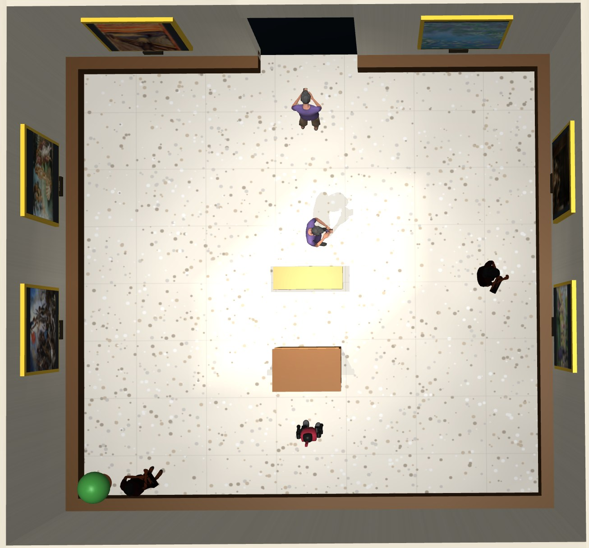
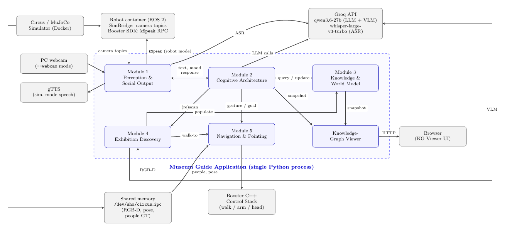
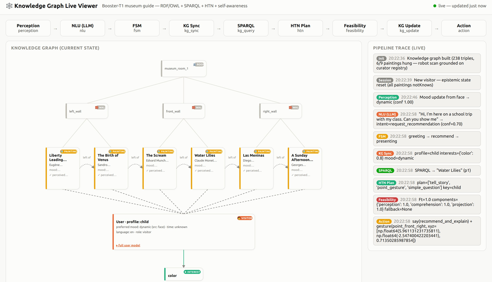
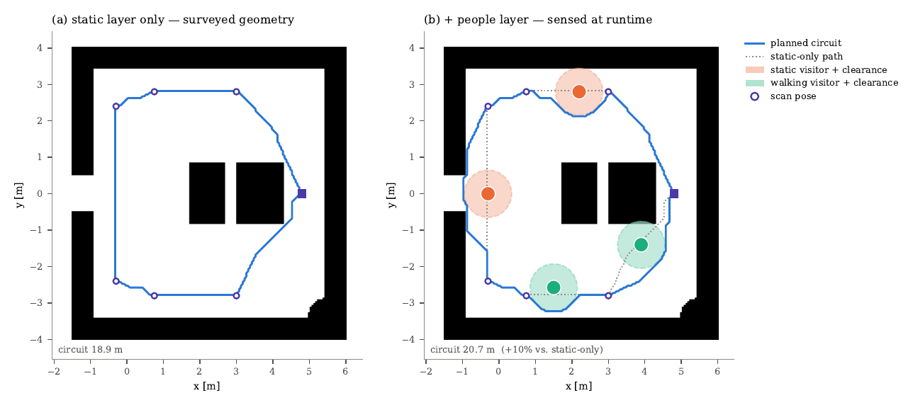
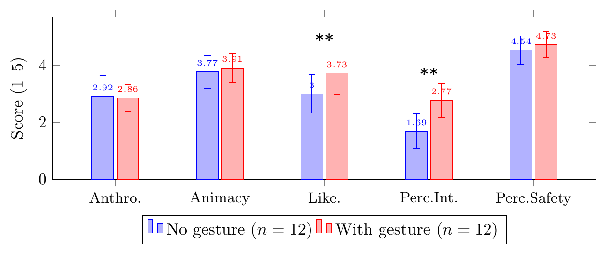

# Booster T1 as a Neuro-Symbolic Museum Guide

**Autonomous artwork discovery and adaptive Human-Robot Interaction**. Course project for Elective in AI / HRAI 2025-26, Sapienza University of Rome.

*Dario Finocchiaro, Valentina Tiberia*

A simulated **Booster T1** humanoid acts as a museum guide. It explores a room it has never seen, works out which paintings are on display and where they hang, and then talks with visitors. It adapts its recommendations and explanations to each visitor and points at the artworks while it explains them.

Foundation models (LLM, VLM, ASR) take care of perception and language. Decisions that should stay inspectable go through an explicit **RDF/OWL knowledge graph**. These include which artworks can be recommended, what the visitor already knows, staff constraints and whether an action is physically feasible.

<p align="center">
  
</p>
<p align="center"><em>The museum room in MuJoCo/Circus: six paintings on three walls, a reception desk, a bench, and static and walking visitors.</em></p>

---

## What the robot does

1. **Discovers the exhibition**: it walks a scanning circuit and stops in front of each wall slot. A VLM recognises each painting (closed-set, from a larger catalogue), and depth back-projection places it in the room. The results build the semantic map and the knowledge graph.
2. **Perceives the visitor**: it detects faces (OpenCV), estimates facial emotion (`hsemotion-onnx`) and transcribes speech (Whisper). Language is detected automatically.
3. **Models the visitor**: it keeps track of interests, profile (child / novice / expert / tourist), available time, mood, language and role. Most of this is inferred from the conversation rather than asked.
4. **Reasons and acts**: a Social Supervisor safety gate, then LLM intent parsing, an FSM dialogue manager, SPARQL recommendation, HTN task decomposition and a feasibility check. The robot then gives a grounded spoken explanation and points at the painting (IK).
5. **Moves safely among people**: A\* on a static occupancy map, plus a people layer with interpersonal clearance and reactive replanning.
6. **Handles operations**: authenticated staff can trigger a rescan or put an artwork under maintenance. The constraint persists across sessions.
7. **Has its own taste**: the robot forms artistic preferences and keeps them across sessions and restarts.
8. **Stays inspectable**: a live web viewer shows the knowledge graph, the semantic map and a step-by-step trace of the reasoning pipeline.

## Architecture

<p align="center"></p>

All core modules run as function calls inside a **single Python process**. ROS 2 (SimBridge) and shared memory (`/dev/shm/circus_ipc`) are used only at the boundary with the simulator. Locomotion, head and arm commands go through the Booster C++ control stack. LLM/VLM (Qwen) and ASR (`whisper-large-v3-turbo`) are called through the Groq API.

## Knowledge Graph Live Viewer

<p align="center"></p>

*Scenario B (child visitor): the graph holds room → walls → discovered paintings → visitor → inferred interests. The right panel traces each turn: Perception → NLU → FSM → KG Sync → SPARQL → HTN → Feasibility → KG Update → Action.*

## Human-aware navigation

<p align="center"></p>

*(a) Planning with the static layer only (18.9 m circuit). (b) With the people layer, perceived visitors get clearance regions and the path detours around them (20.7 m). Pedestrian data from the simulator is filtered through a sensor model with limited range, line-of-sight occlusion and short-term track memory before the planner sees it.*

## Results at a glance

| Benchmark | Result |
|---|---|
| Locomotion | 100% goal success, ~10 cm position error, mean person clearance 1.34 m |
| Painting recognition (VLM) | 100% accuracy over 6 viewpoints × 5 runs, ~0.8 s latency |
| Face emotion (AffectNet samples) | 55.6% raw label, 77.8% mapped mood |
| Pointing IK | 2.19 cm mean residual, 100% convergence, ~4.7 ms |
| NLU (intent + language) | 100% on 21 hand-labelled utterances |
| Exhibition scan task | semantic map and KG match ground truth exactly |
| Interaction scenarios | 60–100% per scenario; failures come from multi-turn state tracking |

<p align="center"></p>

*Synthetic Godspeed study: the pointing gesture significantly improves likeability and perceived intelligence (H1 confirmed). Implicit profile inference was not preferred over explicit profile information (H2 not confirmed).*

## Repository layout

```
HRAI_parrots_report-1.pdf   Project report
*.mp4                       Demo video (4 scenarios)
docs/images/                Figures used in this README
course-project-of-hrai-25-26-parrots-main/
├── circus/                 MuJoCo simulator (Circus) + museum scene (resources/scenes/museo_receptionist.yaml)
├── simbridge/              ROS 2 bridge between the robot container and the simulator
├── dockerfiles/            Robot container image (ROS 2 Humble + Booster SDK)
└── exchange/               Mounted inside the robot container as /app/exchange
    ├── museum_guide_src/   Museum guide application
    │   ├── guida_museale_core.py   main entry point (dialogue loop)
    │   ├── museum_explorer.py      autonomous exhibition scan
    │   ├── scene_randomizer.py     rehang the gallery with 6 random paintings
    │   ├── knowledge_graph.py      RDF/OWL graph + SPARQL
    │   ├── dialogue_manager.py, llm_interpreter.py, social_supervisor.py
    │   ├── path_planner.py, nav_map.py, people_sensor.py, locomotion.py
    │   ├── robot_executor.py, ik/  gestures and pointing
    │   ├── viewer_server.py, viewer/  Knowledge Graph Live Viewer
    │   └── benchmark_*.py          functionality / task benchmarks
    ├── data/               painting catalogue, personality, user profiles, scan results
    └── logs/               benchmark and session logs
```

## Running

Requirements: Linux, [pixi](https://pixi.sh), Docker, and a `GROQ_API_KEY`. See [`circus/docs/circus/installation.md`](course-project-of-hrai-25-26-parrots-main/circus/docs/circus/installation.md) to install Circus and SimBridge. Set the absolute paths in `circus/resources/config/path_constants.yaml`.

```bash
export GROQ_API_KEY=...
cd course-project-of-hrai-25-26-parrots-main/circus

# (optional) rehang the gallery with 6 random paintings from the catalogue
pixi run python ../exchange/museum_guide_src/scene_randomizer.py [--seed N]

# start the simulator with the museum scene, then let the robot scan the room
pixi run python ../exchange/museum_guide_src/museum_explorer.py

# start the museum guide (KG viewer at http://localhost:8009)
pixi run python ../exchange/museum_guide_src/guida_museale_core.py --input-mode voice   # or: text
```

Useful flags for `guida_museale_core.py`: `--camera-index 0` (webcam emotion detection), `--mode robot` (Booster speaker through ROS 2), `--no-gesture`, `--quiet`, `--survey`.

Benchmarks: `pixi run python ../exchange/museum_guide_src/benchmark_<name>.py`. Generate the aggregated report with `benchmark_report.py`.

